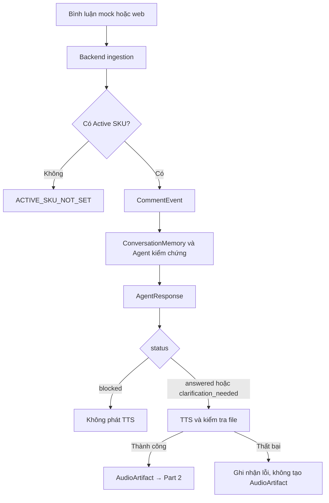

# HOSTRA AI PoC — Đặc tả Data Contracts

> **Phiên bản:** v1  
> **Ngày chốt:** 23/10/2026  
> **Phạm vi đã hoàn thành:** Các schema dùng chung cho Part 1 (Comment → Agent → TTS)  
> **Trạng thái kiểm thử:** 64 tests passed (theo kết quả chạy và xác nhận của nhóm)  
> **Công nghệ:** Python 3.13, Pydantic v2, Pytest

## 1. Mục đích và phạm vi

Tài liệu này là **hợp đồng dữ liệu (data contract)** giữa các module trong HOSTRA AI PoC. Mỗi contract quy định cấu trúc, kiểu dữ liệu, quy tắc validation và trách nhiệm của module tạo/nhận dữ liệu. Mục tiêu là giúp các thành viên phát triển song song mà vẫn trao đổi dữ liệu nhất quán.

Ba contract đã chốt ở Part 1:

| Contract | Đơn vị tạo | Đơn vị sử dụng | Vai trò |
| --- | --- | --- | --- |
| `CommentEvent` | Backend comment ingestion | AI Agent | Bình luận đã chuẩn hóa, có Active SKU snapshot |
| `AgentResponse` | AI Agent sau kiểm chứng | TTS orchestration, audit, giao diện | Kết quả trả lời hoặc từ chối có lý do |
| `AudioArtifact` | TTS service sau kiểm tra file | Part 2 lip-sync, audit | Metadata của file âm thanh TTS hoàn chỉnh |

**Giới hạn hoàn thành:** nhóm đã triển khai và kiểm thử **schema/contract**, chưa đồng nghĩa với việc hoàn tất logic Agent, ConversationMemory, TTS engine hoặc tích hợp end-to-end. Các contract `RenderJob`, `VideoArtifact`, `TimelineEvent`, `AuditRecord` sẽ được đặc tả/kiểm thử ở các bước tương ứng; tài liệu này không tự đặt ra field cho những contract chưa chốt.

### 1.1. Luồng dữ liệu Part 1



## 2. Cấu trúc source code và quy ước import

```text
src/
└── hostra_ai/
    ├── __init__.py
    └── core/
        ├── __init__.py
        └── schemas/
            ├── __init__.py
            ├── common.py
            └── part1.py
```

- `common.py`: chứa `ID_PATTERN` dùng chung.
- `part1.py`: định nghĩa `CommentEvent`, `AgentResponse`, `AudioArtifact`, `AgentReasonCode` và các tập reason code.
- `schemas/__init__.py`: xuất các contract qua một đường import ổn định.
- `hostra_ai/__init__.py` và `core/__init__.py` có thể để trống.

Module khác **nên import thông qua public package**:

```python
from hostra_ai.core.schemas import (
    CommentEvent,
    AgentResponse,
    AudioArtifact,
)
```

Không cần import trực tiếp `hostra_ai.core.schemas.part1` trừ khi có lý do nội bộ rõ ràng.

## 3. Quy ước chung

### 3.1. ID

Các ID định danh sử dụng `str`, bắt buộc có 1–64 ký tự, ký tự đầu là chữ hoặc số và các ký tự tiếp theo chỉ thuộc nhóm chữ, số, dấu chấm, gạch dưới, gạch ngang:

```python
ID_PATTERN = r"^[A-Za-z0-9][A-Za-z0-9._-]*$"
```

Ví dụ hợp lệ: `demo_001`, `viewer-01`, `SKU-A`. Ví dụ không hợp lệ: chuỗi rỗng, `bad/id`, ` viewer01`.

### 3.2. Thời gian

- Các trường `received_at` và `created_at` bắt buộc là datetime **có múi giờ** (`AwareDatetime`).
- Pydantic chuẩn hóa thời gian về **UTC**.
- Khi trao đổi JSON, biểu diễn bằng chuỗi thời gian ISO 8601, ví dụ `2026-10-23T09:30:00Z`.
- Từ chối datetime không có múi giờ; không tự suy đoán timezone.

### 3.3. Cấu hình Pydantic

Ba class dùng `ConfigDict(extra="forbid", frozen=True)`:

- Không cho phép field nằm ngoài contract.
- Không cho phép gán lại thuộc tính sau khi model đã được tạo.
- `AgentResponse.evidence_refs` được lưu dưới dạng **tuple trong Python** để tránh sửa trực tiếp danh sách bằng chứng; khi xuất JSON, trường này vẫn là **array**.

### 3.4. Phân biệt validation theo schema và theo service

**Pydantic** chịu trách nhiệm kiểu dữ liệu, độ dài, pattern, enum, chuẩn hóa chuỗi/thời gian và một số ràng buộc giữa các field trong cùng model.

**Service/integration layer** chịu trách nhiệm kiểm tra tài nguyên thực và quan hệ giữa các model: SKU có tồn tại, comment ID có bị trùng, evidence có thật, giọng nói có quyền sử dụng, file WAV có hợp lệ, các ID giữa các bước có khớp hay không.

## 4. CommentEvent v1

### 4.1. Mục đích

`CommentEvent` biểu diễn một bình luận đã được backend chuẩn hóa. Demo do **một operator** điều khiển nhưng có thể giả lập nhiều người xem bằng các `viewer_id` khác nhau. Cả hai nguồn `mock_comments.json` và form web đều đi qua bước chuẩn hóa trước khi gửi cho Agent.

### 4.2. Các trường

| Field | Kiểu | Bắt buộc | Validation/ý nghĩa |
| --- | --- | --- | --- |
| `comment_id` | `str` | Có | ID 1–64 ký tự; theo `ID_PATTERN`; strict |
| `run_id` | `str` | Có | ID phiên demo; theo `ID_PATTERN`; strict |
| `viewer_id` | `str` | Có | ID người xem giả lập; theo `ID_PATTERN`; strict |
| `source` | `Literal["mock", "web"]` | Có | Chỉ nhận `mock` hoặc `web` |
| `text` | `str` | Có | Cắt khoảng trắng đầu/cuối; 1–1000 ký tự; strict |
| `active_sku_id` | `str` | Có | SKU đang active tại thời điểm nhận; theo `ID_PATTERN`; strict |
| `received_at` | `AwareDatetime` | Có | Timestamp do backend gắn, chuẩn hóa UTC |

### 4.3. Ví dụ JSON hợp lệ

```json
{
  "comment_id": "cmt_001",
  "run_id": "demo_001",
  "viewer_id": "viewer_01",
  "source": "web",
  "text": "Sản phẩm A còn hàng không?",
  "active_sku_id": "SKU-A",
  "received_at": "2026-10-23T09:30:00Z"
}
```

### 4.4. Quy trình tạo event

- **Web:** operator nhập tối thiểu `viewer_id` và `text`; backend sinh `comment_id`, gắn `run_id`, `source="web"`, `active_sku_id` và thời gian.
- **Mock:** dữ liệu đầu vào có thể chứa `comment_id`, `viewer_id`, `text`; backend chuẩn hóa, bổ sung metadata còn thiếu và gắn `source="mock"`.
- `active_sku_id` là **snapshot do backend xác định**, không được tin một SKU do form web tự gửi làm nguồn quyết định.
- Khi **chưa có Active SKU**, backend từ chối trước khi tạo event với mã `ACTIVE_SKU_NOT_SET`.
- Tính duy nhất của `comment_id`, tính hợp lệ của phiên và sự tồn tại của SKU là kiểm tra tại service, không phải Pydantic.

### 4.5. Quan hệ với ConversationMemory

Memory của hội thoại được phân tách theo khóa `(run_id, viewer_id)` và **không nằm trong CommentEvent**. `active_sku_id` chỉ phản ánh màn hình bán hàng tại lúc nhận comment; `resolved_sku_id` trong `AgentResponse` có thể khác sau khi Agent tra cứu ngữ cảnh.

Ví dụ cùng `viewer_01` hỏi lần lượt:

1. “Sản phẩm A còn hàng không?” → `resolved_sku_id="SKU-A"`.
2. “Giá của **sản phẩm ấy** bao nhiêu, mình mua 3 cái?” → Agent có thể tham chiếu `SKU-A` từ lịch sử của đúng viewer này, ngay cả nếu Active SKU trên màn hình đã đổi.

Không được dùng lịch sử của viewer khác để giải nghĩa “sản phẩm ấy”. Khi không đủ căn cứ, Agent cần yêu cầu làm rõ thay vì tự đoán.

## 5. AgentResponse v1

### 5.1. Mục đích

`AgentResponse` là kết quả **cuối cùng sau xử lý và kiểm chứng**, không phải JSON thô do LLM tạo. Nội dung được phép đưa đến TTS chỉ khi thỏa các quy tắc trạng thái và nghiệp vụ.

### 5.2. Các trường

| Field | Kiểu | Bắt buộc | Validation/ý nghĩa |
| --- | --- | --- | --- |
| `response_id` | `str` | Có | ID response; 1–64 ký tự, pattern, strict |
| `comment_id` | `str` | Có | Liên kết CommentEvent nguồn; pattern, strict |
| `run_id` | `str` | Có | Phiên demo; pattern, strict |
| `viewer_id` | `str` | Có | Người xem tương ứng; pattern, strict |
| `resolved_sku_id` | `str \| null` | Có | SKU đã giải nghĩa; ID hợp lệ khi khác null |
| `status` | `Literal` | Có | `answered`, `clarification_needed`, `blocked` |
| `answer_text` | `str \| null` | Có | Cắt khoảng trắng; 1–500 ký tự nếu khác null |
| `evidence_refs` | JSON `array[string]` | Có | Tối đa 10 phần tử; mỗi ref 1–128 ký tự sau trim; không trùng |
| `reason_code` | `AgentReasonCode \| null` | Có | Mã lý do tương ứng trạng thái |
| `created_at` | `AwareDatetime` | Có | Chuẩn hóa UTC |

> Các field có thể nhận `null` (`resolved_sku_id`, `answer_text`, `reason_code`) **vẫn bắt buộc xuất hiện** trong JSON. Trong Python, `evidence_refs` dùng `tuple[str, ...]`; ngoài hệ thống, JSON vẫn dùng array.

### 5.3. Các trạng thái và ràng buộc

| `status` | `answer_text` | `reason_code` | Điều kiện bổ sung | Có được gọi TTS? |
| --- | --- | --- | --- | --- |
| `answered` | Bắt buộc có | `null` | Nếu `resolved_sku_id != null` thì `evidence_refs` không rỗng | Có, nếu service cho phép |
| `clarification_needed` | Bắt buộc có | Một mã clarification | Hỏi lại khi chưa đủ thông tin | Có, nếu service cho phép |
| `blocked` | **`null`** | Một mã blocked | Không tạo audio | **Không** |

**Clarification reasons:**

- `REFERENCE_AMBIGUOUS`: đối tượng tham chiếu không rõ.
- `DETAIL_MISSING`: thiếu dữ liệu cần thiết để trả lời.
- `PRODUCT_NOT_FOUND`: không xác định được sản phẩm.

**Blocked reasons:**

- `VERIFICATION_FAILED`: không qua kiểm chứng.
- `CATALOG_UNAVAILABLE`: không truy cập được catalog.
- `UNSUPPORTED_REQUEST`: yêu cầu ngoài phạm vi hỗ trợ.
- `INTERNAL_ERROR`: lỗi xử lý nội bộ.

### 5.4. Validation của evidence_refs

- Cắt khoảng trắng đầu/cuối từng ref.
- Từ chối chuỗi rỗng hoặc dài hơn 128 ký tự.
- Từ chối ref trùng nhau sau khi chuẩn hóa.
- Từ chối trên 10 ref.
- Dữ liệu được lưu bất biến dạng tuple trong Python, nhưng tuần tự hóa thành JSON array.
- **Có ref không đồng nghĩa evidence đúng**: tính xác thực, liên hệ với SKU và đủ căn cứ phải được kiểm tra ở verification service.

### 5.5. Ví dụ: answered

```json
{
  "response_id": "resp_001",
  "comment_id": "cmt_001",
  "run_id": "demo_001",
  "viewer_id": "viewer_01",
  "resolved_sku_id": "SKU-A",
  "status": "answered",
  "answer_text": "Sản phẩm A hiện vẫn còn hàng ạ!",
  "evidence_refs": ["catalog:SKU-A:stock"],
  "reason_code": null,
  "created_at": "2026-10-23T09:30:02Z"
}
```

### 5.6. Ví dụ: clarification_needed

```json
{
  "response_id": "resp_002",
  "comment_id": "cmt_002",
  "run_id": "demo_001",
  "viewer_id": "viewer_02",
  "resolved_sku_id": null,
  "status": "clarification_needed",
  "answer_text": "Bạn đang hỏi sản phẩm nào để mình kiểm tra giúp ạ?",
  "evidence_refs": [],
  "reason_code": "REFERENCE_AMBIGUOUS",
  "created_at": "2026-10-23T09:30:04Z"
}
```

### 5.7. Ví dụ: blocked

```json
{
  "response_id": "resp_003",
  "comment_id": "cmt_003",
  "run_id": "demo_001",
  "viewer_id": "viewer_03",
  "resolved_sku_id": "SKU-A",
  "status": "blocked",
  "answer_text": null,
  "evidence_refs": [],
  "reason_code": "VERIFICATION_FAILED",
  "created_at": "2026-10-23T09:30:05Z"
}
```

## 6. AudioArtifact v1

### 6.1. Mục đích

`AudioArtifact` là metadata của **file TTS đã tạo và kiểm tra thành công**, phục vụ đầu vào Part 2 (lip-sync). Nó **không** đại diện cho một TTS job đang chạy, thất bại hay bị chặn.

### 6.2. Các trường

| Field | Kiểu | Bắt buộc | Validation/ý nghĩa |
| --- | --- | --- | --- |
| `audio_id` | `str` | Có | ID audio; 1–64 ký tự, pattern, strict |
| `response_id` | `str` | Có | Liên kết AgentResponse; pattern, strict |
| `run_id` | `str` | Có | Phiên demo; pattern, strict |
| `voice_id` | `str` | Có | ID giọng được chọn; pattern, strict |
| `file_path` | `str` | Có | Đường dẫn WAV tương đối, an toàn; tối đa 255 ký tự; strict |
| `format` | `Literal["wav"]` | Có | Chỉ chấp nhận `wav` |
| `codec` | `Literal["pcm_s16le"]` | Có | Chỉ chấp nhận PCM signed 16-bit |
| `sample_rate_hz` | `int` | Có | Số nguyên strict, từ 8.000 đến 96.000 Hz |
| `channels` | `Literal[1]` | Có | Âm thanh mono |
| `duration_ms` | `int` | Có | Số nguyên strict, lớn hơn 0 |
| `created_at` | `AwareDatetime` | Có | Thời điểm hoàn tất, chuẩn hóa UTC |

### 6.3. Ví dụ JSON hợp lệ

```json
{
  "audio_id": "aud_001",
  "response_id": "resp_001",
  "run_id": "demo_001",
  "voice_id": "demo_voice_01",
  "file_path": "outputs/audio/aud_001.wav",
  "format": "wav",
  "codec": "pcm_s16le",
  "sample_rate_hz": 24000,
  "channels": 1,
  "duration_ms": 3200,
  "created_at": "2026-10-23T09:30:06Z"
}
```

### 6.4. Quy ước file âm thanh

- Định dạng giao tiếp nội bộ: **WAV / PCM signed 16-bit / mono**.
- `sample_rate_hz` ghi lại **sample rate thực tế** của file; contract cho phép khoảng 8.000–96.000 Hz, **không có nghĩa model lip-sync nào cũng dùng trực tiếp được mọi giá trị**. Adapter của Part 2 phải kiểm tra và resample nếu cần.
- `duration_ms` là số mili-giây thực tế, lớn hơn 0.
- Đường dẫn được hiểu tương đối so với **thư mục dữ liệu chung được backend cấu hình**. `outputs/audio/aud_001.wav` chỉ là ví dụ; prefix này chưa bị ép cứng trong schema.

`file_path` không được là đường dẫn tuyệt đối Windows/POSIX, không chứa `\\`, dấu `:`, ký tự điều khiển, path traversal `..`, thành phần trống/bất thường; phải kết thúc bằng `.wav`.

### 6.5. Kiểm tra bắt buộc ở TTS service

Trước khi tạo `AudioArtifact`, service phải bảo đảm:

1. `AgentResponse` nguồn tồn tại, cùng `run_id`, có trạng thái cho phép TTS và có `answer_text`.
2. `voice_id` hợp lệ và có quyền sử dụng trong phạm vi demo.
3. File đã được ghi xong, tồn tại và có thể đọc.
4. Đường dẫn đã resolve vẫn nằm trong thư mục được phép (bao gồm kiểm tra symlink/path traversal thực tế).
5. Nội dung file là WAV PCM16 mono; sample rate và thời lượng khớp với metadata.
6. Chỉ thông báo cho Part 2 sau khi tất cả kiểm tra thành công.

**Nếu TTS lỗi hoặc file sai định dạng:** không tạo `AudioArtifact` giả với thời lượng `0`; ghi nhận lỗi tại tầng service/audit và không chuyển file sang Part 2.

## 7. Ràng buộc xuyên suốt giữa ba contract

Các điều kiện dưới đây **không thể được bảo đảm chỉ bằng việc validate từng model Pydantic độc lập**.

| Ràng buộc | Nơi kiểm tra |
| --- | --- |
| `CommentEvent.comment_id == AgentResponse.comment_id` | Agent orchestration / integration test |
| `CommentEvent.run_id == AgentResponse.run_id` | Agent orchestration / integration test |
| `CommentEvent.viewer_id == AgentResponse.viewer_id` | Agent orchestration / integration test |
| `AgentResponse.response_id == AudioArtifact.response_id` | TTS orchestration / integration test |
| `AgentResponse.run_id == AudioArtifact.run_id` | TTS orchestration / integration test |
| `received_at <= AgentResponse.created_at <= AudioArtifact.created_at` trong luồng tuần tự | Orchestration / integration test |
| `AgentResponse.status == "blocked"` → tuyệt đối không gọi TTS và không sinh audio | TTS orchestration / integration test |
| `answered` chỉ phát sau khi kiểm chứng dữ liệu thành công | Agent verification service |
| File WAV, sample rate và quyền sử dụng voice hợp lệ | Audio/voice service |

Các comment mới phải được xử lý theo đúng viewer; không dùng ConversationMemory của viewer khác. `resolved_sku_id` không bị ép phải bằng `active_sku_id` vì người xem có thể hỏi tiếp một sản phẩm đã nhắc đến trước đó.

## 8. Quy tắc lỗi và xử lý bất thường

| Tình huống | Hành vi/mã xử lý |
| --- | --- |
| Chưa chọn Active SKU | Backend từ chối: `ACTIVE_SKU_NOT_SET`; không tạo `CommentEvent` |
| Thiếu field, sai kiểu, ID sai pattern, naive datetime, field lạ | Pydantic phát sinh `ValidationError`; lớp API chịu trách nhiệm ánh xạ sang lỗi HTTP phù hợp |
| Bình luận rỗng sau khi trim hoặc quá 1.000 ký tự | Từ chối `CommentEvent` |
| `answered` thiếu `answer_text` | `ANSWER_TEXT_REQUIRED` |
| `answered` có `reason_code` | `REASON_CODE_MUST_BE_NULL` |
| Trả lời có `resolved_sku_id` nhưng không có evidence ref | `EVIDENCE_REQUIRED` |
| `clarification_needed` thiếu câu hỏi làm rõ | `CLARIFICATION_TEXT_REQUIRED` |
| Reason của clarification không hợp lệ | `INVALID_CLARIFICATION_REASON` |
| `blocked` vẫn có `answer_text` | `BLOCKED_RESPONSE_CANNOT_HAVE_TEXT` |
| Reason của blocked không hợp lệ | `INVALID_BLOCK_REASON` |
| Evidence rỗng/quá dài hoặc bị trùng | `INVALID_EVIDENCE_REFERENCE` / `DUPLICATE_EVIDENCE_REFERENCE` |
| File audio không tồn tại, hỏng, sai codec hoặc TTS thất bại | Không tạo `AudioArtifact`; xử lý qua lỗi service/audit (chưa chốt mã lỗi TTS cụ thể) |

> Các chuỗi lỗi của validator ở bảng là **thông báo/mã nội bộ trong validation**. Chưa mặc định xem tất cả chúng là mã lỗi HTTP công khai. `ACTIVE_SKU_NOT_SET` là quy tắc nghiệp vụ do backend kiểm tra trước khi tạo event.

## 9. Kiểm thử và tiêu chí nghiệm thu

### 9.1. Các bộ test hiện có

| Nhóm test | Số lượng |
| --- | ---: |
| Unit tests — `CommentEvent` | 12 |
| Contract tests — `CommentEvent` | 6 |
| Unit tests — `AgentResponse` | 17 |
| Contract tests — `AgentResponse` | 7 |
| Unit tests — `AudioArtifact` | 17 |
| Contract tests — `AudioArtifact` | 5 |
| **Tổng** | **64** |

Lệnh chạy từ thư mục gốc của repo:

```bash
python -m pytest -q
```

**Kết quả được nhóm xác nhận ngày 23/10/2026:** `64 passed` sau khi chuyển sang cấu trúc `core/schemas/` và sửa kỳ vọng tuple trong test `evidence_refs`.

### 9.2. Acceptance checklist cho giai đoạn contract

- [x] Chốt `CommentEvent v1` hỗ trợ mock và web.
- [x] Backend là nguồn gắn Active SKU; không có Active SKU thì từ chối.
- [x] Có `viewer_id` và `run_id` để phân biệt hội thoại.
- [x] Chốt `AgentResponse v1` với ba trạng thái, reason code và evidence.
- [x] Chốt `blocked` không phát TTS.
- [x] Chốt `AudioArtifact v1` cho file TTS WAV PCM16 mono.
- [x] Tách `schemas/part1.py`, `schemas/common.py` và public exports trong `schemas/__init__.py`.
- [x] Hoàn thành 64 unit/contract tests (theo kết quả nhóm báo cáo).
- [ ] Viết integration tests giữa comment ingestion, Agent, TTS và audio validation khi các service được triển khai.
- [ ] Hoàn thiện ConversationMemory runtime, Agent verification và TTS engine.
- [ ] Tích hợp/kiểm thử với Part 2 lip-sync.

## 10. Bàn giao và quản lý thay đổi

- **Nguồn chuẩn (source of truth):** Pydantic models trong `src/hostra_ai/core/schemas/`; tài liệu phải được cập nhật khi contract thay đổi.
- Consumer nên import bằng `from hostra_ai.core.schemas import ...` để không phụ thuộc cấu trúc file nội bộ.
- Khi đề xuất thay field, enum, validation hoặc JSON shape: trao đổi với các thành viên bị ảnh hưởng, cập nhật unit/contract tests, ví dụ JSON và tài liệu này trước khi merge PR.
- Các schema Part 2/3 chỉ bổ sung khi có người chịu trách nhiệm và contract cụ thể đã được chốt. Không coi placeholder là contract đã triển khai.

**Trạng thái kết thúc ngày 23/10/2026:** hoàn tất phạm vi **thiết kế + Pydantic + unit/contract tests cho các shared schemas của Part 1**. Công việc triển khai thực tế các service và kiểm thử tích hợp được tiếp tục ở giai đoạn sau.
