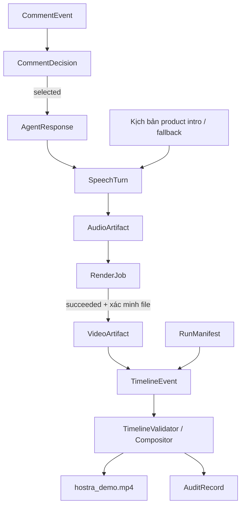
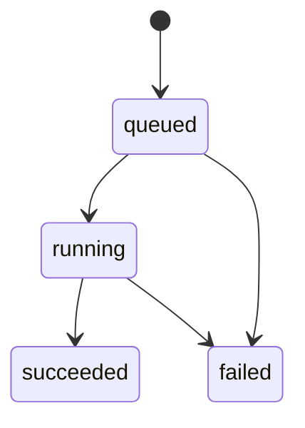

# HOSTRA AI PoC — Data Contract

> **Tài liệu kỹ thuật và bàn giao nội bộ**  
> **Ngày tổng hợp:** 25/10/2026  
> **Vị trí đề xuất trong repository:** `docs/data_contract.md`  
> **Phạm vi:** Part 1 (Comment → Audio), Part 2 (Lip-sync), Part 3 (Timeline → Final Video & Audit)  
> **Cơ sở:** Ba bản ghi chú Data Contract Part 1, Part 2 và Part 3 ngày 25/10/2026. Tài liệu này mô tả **hợp đồng dữ liệu theo thiết kế đã thống nhất**, không xác nhận toàn bộ service/media pipeline đã triển khai.

## 1. Mục đích và cách đọc

Data Contract quy định định dạng các bản ghi mà các module trao đổi, bao gồm tên trường, kiểu, tính bắt buộc, giá trị hợp lệ, trạng thái, quan hệ truy vết và trách nhiệm kiểm tra. Các thành viên triển khai producer và consumer phải dựa vào cùng một quy ước, tránh việc mỗi module tự suy diễn JSON hoặc tự đặt trạng thái.

**Đọc nhanh theo vai trò:**

- Người làm **Agent/Triage/TTS**: mục 2–4, 7, 9.
- Người làm **Lip-sync Worker**: mục 2–3, 5, 7–9.
- Người làm **Scheduler/Compositor/UI**: mục 2–3, 6–9.
- Người làm **QA/Integration**: mục 3, 7–11 và phụ lục ví dụ.

| Part | Schema | Số trường | Chức năng |
|---|---|---:|---|
| 1 | `CommentEvent` | 7 | Bình luận đã ingest và gắn Active SKU |
| 1 | `CommentDecision` | 9 | Kết quả Triage |
| 1 | `AgentResponse` | 10 | Kết quả Agent đã qua bước kiểm chứng |
| 1 | `SpeechTurn` | 9 | Lượt phát ngôn được phép đưa đến Scheduler/TTS |
| 1 | `AudioArtifact` | 12 | Metadata WAV đã tạo thành công |
| 2 | `RenderJob` | 13 | Snapshot một lần thử render lip-sync |
| 2 | `VideoArtifact` | 14 | Metadata video lip-sync đã kiểm định |
| 3 | `RunManifest` | 13 | Cấu hình run và mốc gốc timeline |
| 3 | `TimelineEvent` | 13 | Đoạn clip/pause trên video đích |
| 3 | `AuditRecord` | 10 | Nhật ký có thể truy vết xuyên module |
| **Tổng** | **10 schema** | **110** | **5 + 2 + 3 schema** |

### 1.1. Luồng dữ liệu tổng thể



Sơ đồ thể hiện **luồng logic**, không có nghĩa mọi `SpeechTurn` đều bắt nguồn từ bình luận: `product_intro` và một số `safe_fallback` có thể đến từ kịch bản được duyệt. `RenderJob.failed` không tạo `VideoArtifact`; bình luận bị bỏ qua cũng không tự động sinh phản hồi.

## 2. Nguyên tắc kiến trúc bắt buộc

### 2.1. Ba lớp kiểm tra

| Lớp | Được phép kiểm tra | Không nên thực hiện |
|---|---|---|
| **Schema (Pydantic)** | Kiểu, field bắt buộc, giới hạn, enum/literal, tổ hợp field **trong một bản ghi**, dạng đường dẫn/timestamp | I/O, truy vấn DB, mở media, gọi LLM/FFprobe, xác minh ID của bản ghi khác |
| **Service** | Nghiệp vụ Triage/Agent/Scheduler, liên kết các record, license/consent, tồn tại file, trạng thái lịch sử, retry, media probe | Tin rằng JSON hợp lệ đồng nghĩa kết quả đã an toàn/đã render xong |
| **Integration/E2E** | Luồng xuyên Part, media thực, FPS/PTS, A/V sync, hiệu năng, fail/retry, trạng thái UI | Lấy số lượng schema tests làm bằng chứng cho chất lượng lip-sync |

**Bất biến trọng tâm:** `model_validate()` thành công chỉ chứng minh bản ghi tuân theo schema, không chứng minh các tham chiếu/file/bằng chứng ngoài đời thực là hợp lệ.

### 2.2. Quy ước chung

| Chủ đề | Quy tắc |
|---|---|
| Framework | Pydantic v2, `ConfigDict(extra="forbid", frozen=True)` cho cả 10 model |
| ID | `^[A-Za-z0-9][A-Za-z0-9._-]*$`, tối đa **64 ký tự**, áp dụng các trường định danh theo ghi chú từng Part |
| Số nguyên | Các giá trị được ghi **strict** không nhận chuỗi số, số thực hoặc `bool` thay cho `int` |
| Timestamp | `AwareDatetime`: bắt buộc có timezone, chuẩn hóa về UTC; không nhận datetime naive |
| Nullable | Trường viết `T | None` với `Field(...)` **vẫn phải có key** trong JSON; `null` khác với thiếu key |
| Tính bất biến | Bản ghi là snapshot; chuyển trạng thái bằng cách tạo dữ liệu mới và `model_validate()` lại |
| Cập nhật | Tránh `model_copy(update=...)` với dữ liệu chưa validate vì không mặc nhiên chạy lại toàn bộ validator |
| Chuỗi | Chỉ tự trim ở trường có quy định rõ; không âm thầm sửa đường dẫn không canonical |
| File path | Relative POSIX (dấu `/`), không đường dẫn tuyệt đối/traversal; kiểm tra path đã resolve và symlink tại tầng I/O |
| Reason code | Mã máy đọc được theo `UPPER_SNAKE_CASE` tại các nơi ghi chú yêu cầu; không tự thêm enum mới |
| JSON | Timestamp biểu diễn theo ISO 8601 có timezone; tuple Python (ví dụ `evidence_refs`) xuất ra JSON array |

Các model hiện tại **không có field `schema_version`**. `policy_version` trong `CommentDecision` là phiên bản *chính sách Triage*, không phải phiên bản toàn bộ hợp đồng dữ liệu. Việc versioning cho các file container như `timeline.json` cần chốt riêng khi có producer và consumer thật.

## 3. Part 1 — Bình luận, Agent, lượt nói và TTS

### 3.1. `CommentEvent` (7 trường)

Đại diện một bình luận mà backend đã nhận, chuẩn hóa và gắn SKU đang bán tại thời điểm nhận.

| Trường | Kiểu | Quy tắc / ý nghĩa |
|---|---|---|
| `comment_id` | `str` | ID bình luận, hợp lệ/≤64 |
| `run_id` | `str` | ID phiên, hợp lệ/≤64 |
| `viewer_id` | `str` | ID người xem, hợp lệ/≤64 |
| `source` | `Literal["mock", "web"]` | Nguồn comment giả lập hoặc form web |
| `text` | `str` | Trim đầu/cuối, không rỗng, tối đa 1.000 ký tự |
| `active_sku_id` | `str` | SKU đang hoạt động, **bắt buộc có giá trị** |
| `received_at` | `AwareDatetime` | Thời điểm backend nhận, chuẩn hóa UTC |

**Nghiệp vụ:** Ingestion phải lấy Active SKU tại lúc nhận. Nếu chưa có, **từ chối tạo `CommentEvent`** với mã service `ACTIVE_SKU_NOT_SET`; mã này **không phải field** của schema. Một follow-up như “sản phẩm ấy” vẫn có `active_sku_id` tại lúc nhận, còn SKU thực sự được câu hỏi nhắc tới do Agent/Conversation Memory giải quyết.

### 3.2. `CommentDecision` (9 trường)

Snapshot quyết định của Comment Triage; một comment có thể được đánh giá lại bởi một `decision_id` khác.

| Trường | Kiểu | Quy tắc / ý nghĩa |
|---|---|---|
| `decision_id` | `str` | ID lần đánh giá |
| `run_id` | `str` | Run liên quan |
| `comment_id` | `str` | Tham chiếu `CommentEvent` |
| `action` | `TriageAction` | Xem bảng trạng thái |
| `reason_code` | `TriageReasonCode \| None` | Bắt buộc key, lý do theo action |
| `priority_score` | `int` | Từ 0 đến 100 |
| `duplicate_of` | `str \| None` | Bắt buộc key; ID comment gốc nếu trùng |
| `policy_version` | `str` | Định danh cấu hình chính sách áp dụng |
| `decided_at` | `AwareDatetime` | UTC |

| `action` | `reason_code` hợp lệ | Ý nghĩa |
|---|---|---|
| `selected` | `null` | Chọn để xử lý |
| `deferred` | `LOW_PRIORITY`, `QUEUE_BUSY`, `RATE_LIMITED` | Hoãn |
| `skipped` | `SPAM`, `DUPLICATE`, `OFF_TOPIC`, `EXPIRED` | Không xử lý tiếp |
| `escalated` | `HUMAN_REQUIRED` | Chuyển cho người |

Invariant nội bộ: `priority_score` trong `[0,100]`; `reason_code` phải tương thích `action`; chỉ khi `reason_code=DUPLICATE` mới được có `duplicate_of`, và `duplicate_of != comment_id`. Trường hợp khác `duplicate_of=null`.

**Quy tắc tại Triage Service (đề xuất cấu hình):** phát hiện duplicate trong cùng `run_id`, cùng `viewer_id`, nội dung tương đương sau chuẩn hóa hoa/thường và khoảng trắng trong cửa sổ 30 giây; **giữ dấu tiếng Việt**. Deferred TTL 30 giây từ `CommentEvent.received_at`; có thể tái đánh giá hoặc xuất `skipped/EXPIRED`. Không hard-code chính sách này trong validator.

### 3.3. `AgentResponse` (10 trường)

Đây là **kết quả hậu kiểm chứng**, không phải raw output của LLM.

| Trường | Kiểu | Quy tắc / ý nghĩa |
|---|---|---|
| `response_id` | `str` | ID phản hồi |
| `comment_id` | `str` | Comment nguồn |
| `run_id` | `str` | Run |
| `viewer_id` | `str` | Viewer |
| `resolved_sku_id` | `str \| None` | SKU được suy giải; key bắt buộc |
| `status` | `Literal["answered", "clarification_needed", "blocked"]` | Trạng thái sau verification |
| `answer_text` | `str \| None` | Nội dung được phép dùng hoặc `null` |
| `evidence_refs` | `tuple[str, ...]` | Danh sách tham chiếu bằng chứng dạng tuple |
| `reason_code` | `AgentReasonCode \| None` | Mã lý do; key bắt buộc |
| `created_at` | `AwareDatetime` | UTC |

| `status` | `answer_text` | `evidence_refs` | `reason_code` | Có thể tạo lời thoại? |
|---|---|---|---|---|
| `answered` | Bắt buộc có nội dung | **Ít nhất 1** | `null` | Có, sau đối chiếu bằng chứng |
| `clarification_needed` | Bắt buộc có nội dung | Có thể rỗng | `REFERENCE_AMBIGUOUS`, `DETAIL_MISSING`, `PRODUCT_NOT_FOUND` | Có, để hỏi rõ |
| `blocked` | **`null`** | **Rỗng `()`** | `VERIFICATION_FAILED`, `CATALOG_UNAVAILABLE`, `UNSUPPORTED_REQUEST`, `INTERNAL_ERROR` | **Không dùng nội dung Agent**; chỉ fallback theo script được duyệt |

**`evidence_refs`:** tối đa 10 phần tử; mỗi phần tử tối đa 128 ký tự sau trim, không rỗng, không trùng sau chuẩn hóa, không chứa control characters (ví dụ `\n`, `\t` bên trong hoặc DEL). JSON serialize thành array. Việc tham chiếu có tồn tại và thật sự hỗ trợ nhận định phải do Verified Agent Service kiểm tra. Không tự biến `blocked` thành `answered` chỉ vì model trả về văn bản.

### 3.4. `SpeechTurn` (9 trường)

Định nghĩa **lời thoại được phép đưa tới Scheduler/TTS**, không phải trạng thái hàng đợi hoặc playback.

| Trường | Kiểu | Quy tắc / ý nghĩa |
|---|---|---|
| `speech_turn_id` | `str` | ID lượt nói |
| `run_id` | `str` | Run |
| `speech_type` | `SpeechType` | Ba loại bên dưới |
| `sku_id` | `str \| None` | SKU liên quan; key bắt buộc |
| `text` | `str` | Lời thoại được phép phát |
| `response_id` | `str \| None` | Liên kết AgentResponse; key bắt buộc |
| `script_ref` | `str \| None` | Tham chiếu kịch bản đã duyệt; key bắt buộc |
| `priority` | `int` | 0–100 |
| `created_at` | `AwareDatetime` | UTC |

| `speech_type` | `sku_id` | `response_id` | `script_ref` | Nguồn nội dung |
|---|---|---|---|---|
| `comment_reply` | Theo ngữ cảnh, có thể `null` | **Bắt buộc** | `null` | `AgentResponse.answered` hoặc `clarification_needed` |
| `product_intro` | **Bắt buộc** | `null` | **Bắt buộc** | Kịch bản giới thiệu sản phẩm |
| `safe_fallback` | Theo ngữ cảnh | ID response bị chặn **hoặc** `null` | **Bắt buộc** | Kịch bản fallback đã duyệt |

Service phải kiểm tra nội dung `comment_reply` tương thích `AgentResponse`; nếu `safe_fallback` gắn response bị chặn, chỉ phát script an toàn, không phát văn bản chưa xác minh. Scheduler xử lý đề xuất: **một audio tại một thời điểm**, không cắt ngang, ưu tiên `safe_fallback > comment_reply > product_intro`, cùng ưu tiên FIFO; khi SKU thay đổi trước lúc phát thì hoãn và timeout (đề xuất 30 giây). Đây là **runtime policy**, không có field queue-state trong schema.

### 3.5. `AudioArtifact` (12 trường)

Metadata được tạo **chỉ sau khi TTS đã sinh và service kiểm tra WAV thành công**.

| Trường | Kiểu | Quy tắc / ý nghĩa |
|---|---|---|
| `audio_id` | `str` | ID audio, khớp tên file |
| `speech_turn_id` | `str` | Tham chiếu bắt buộc tới lượt nói |
| `response_id` | `str \| None` | Key bắt buộc; có thể `null` |
| `run_id` | `str` | Run |
| `voice_id` | `str` | Giọng dùng để đọc |
| `file_path` | `str` | Đường dẫn WAV tương đối, đúng run và audio ID |
| `format` | `Literal["wav"]` | Container WAV |
| `codec` | `Literal["pcm_s16le"]` | PCM signed 16-bit little-endian |
| `sample_rate_hz` | `int` | 8.000–96.000 Hz |
| `channels` | `Literal[1]` | Mono |
| `duration_ms` | `int` | Lớn hơn 0 |
| `created_at` | `AwareDatetime` | UTC |

Path bắt buộc có dạng:

```text
shared_data/runs/<run_id>/step1_agent_audio/audio/<audio_id>.wav
```

Không nhận dấu cách/ký tự lạ trong tên file, traversal, tên không khớp `audio_id`, hoặc file ở run khác. Các trường `response_id`, `speech_turn_id` phải khớp `SpeechTurn` nguồn ở tầng Service. File tồn tại, WAV header, codec, thời lượng và sample rate phải được kiểm chứng thực tế; sample rate cụ thể cần tương thích Worker Part 2.

## 4. Part 2 — Lip-sync video

### 4.1. `RenderJob` (13 trường)

Một `RenderJob` biểu diễn **một lần thử render** tại một thời điểm. Retry cần `render_job_id` mới; không tái dùng ID cũ để giả lập một lịch sử khác.

| Trường | Kiểu | Quy tắc / ý nghĩa |
|---|---|---|
| `render_job_id` | `str` | ID duy nhất cho lần thử |
| `run_id` | `str` | Run |
| `audio_id` | `str` | Tham chiếu AudioArtifact |
| `speech_turn_id` | `str` | Tham chiếu SpeechTurn (lặp có chủ đích để truy vết) |
| `source_video_path` | `str` | `shared_data/inputs/<filename>.mp4`, tối đa 255 ký tự, không thư mục con |
| `avatar_id` | `str` | Avatar yêu cầu sử dụng |
| `license_ref` | `str` | Tham chiếu giấy phép, **không đồng nghĩa đã có consent hợp lệ** |
| `status` | `RenderStatus` | `queued`, `running`, `succeeded`, `failed` |
| `created_at` | `AwareDatetime` | UTC |
| `started_at` | `AwareDatetime \| None` | Key bắt buộc, có thể `null` |
| `finished_at` | `AwareDatetime \| None` | Key bắt buộc, có thể `null` |
| `output_video_id` | `str \| None` | Key bắt buộc, chỉ có khi succeeded |
| `error_code` | `str \| None` | Key bắt buộc, mã UPPER_SNAKE_CASE khi failed |

| `status` | `started_at` | `finished_at` | `output_video_id` | `error_code` |
|---|---|---|---|---|
| `queued` | `null` | `null` | `null` | `null` |
| `running` | Có | `null` | `null` | `null` |
| `succeeded` | Có | Có | Có | `null` |
| `failed` | Có hoặc `null` | Có | `null` | Có |

Khi có các thời điểm tương ứng, phải đảm bảo `created_at <= started_at <= finished_at`. `failed` với `started_at=null` là hợp lệ nếu lỗi xảy ra ở License Gate/input preflight trước khi Worker chạy.



**Phân định:** Pydantic kiểm tra một snapshot có nhất quán; Render Controller kiểm tra transition lịch sử không quay ngược, bảo đảm idempotency và retry. Không tự thêm `cancelled` hoặc field trạng thái runtime khi chưa thống nhất contract.

Đường dẫn `source_video_path` phải canonical, không tự `.strip()` rồi nhận giá trị đã bị sửa; stem file hợp ID pattern. License Gate ở service phải xác minh avatar, phạm vi sử dụng, thời hạn, consent và trạng thái thu hồi trước khi render.

### 4.2. `VideoArtifact` (14 trường)

Chỉ xuất hiện khi một job `succeeded` **và output video đã được service kiểm định**.

| Trường | Kiểu | Quy tắc / ý nghĩa |
|---|---|---|
| `video_id` | `str` | ID, khớp stem MP4 |
| `render_job_id` | `str` | Job đã tạo video |
| `audio_id` | `str` | Audio đầu vào |
| `run_id` | `str` | Run |
| `speech_turn_id` | `str` | SpeechTurn nguồn |
| `file_path` | `str` | MP4 dưới đúng run, tối đa 255 ký tự |
| `format` | `Literal["mp4"]` | MP4 |
| `codec` | `str` | Codec thực tế từ FFprobe; `[a-z0-9_]`, ≤32 ký tự |
| `duration_ms` | `int` | 1–600.000 ms |
| `width_px` | `int` | 64–4096 |
| `height_px` | `int` | 64–4096 |
| `fps` | `float` | Hữu hạn, `0 < fps <= 120` |
| `has_audio_track` | `bool` | Video thực tế có track âm thanh hay không |
| `created_at` | `AwareDatetime` | UTC |

Path phải đúng:

```text
shared_data/runs/<run_id>/step2_lipsync/overlays/<video_id>.mp4
```

Phân biệt lỗi `VIDEO_FILE_OUTSIDE_RUN_DIRECTORY` (sai run/thư mục) và `VIDEO_FILENAME_ID_MISMATCH` (stem khác ID). `VideoArtifact` **không** diễn đạt render đang chạy hoặc thất bại. Metadata phải lấy từ media probe; thông số trong giới hạn schema chưa chứng minh lip-sync đạt chất lượng.

**Âm thanh:** `has_audio_track=false` → Part 3 ghép từ AudioArtifact; `true` → Compositor phải chọn giữ hay thay track, tuyệt đối tránh phát lặp hai bản audio. Chính sách cụ thể thuộc Media Pipeline.

## 5. Part 3 — Run, timeline và audit

PoC ưu tiên **video dựng sẵn (`pre_rendered`) và CFR 25 FPS**. Các giới hạn trong schema cho phép FPS khác 25 để phục vụ kiểm thử/cấu hình, nhưng không có nghĩa mọi FPS đã được benchmark.

### 5.1. `RunManifest` (13 trường)

Snapshot mô tả phiên demo và hệ quy chiếu thời gian của video đích.

| Trường | Kiểu | Quy tắc / ý nghĩa |
|---|---|---|
| `run_id` | `str` | ID run ≤64 |
| `base_video_path` | `str` | `shared_data/inputs/<name>.mp4`, ≤255, không subfolder |
| `base_duration_ms` | `int` strict | 1–3.600.000 ms (tối đa 60 phút) |
| `fps` | `float` | Hữu hạn, `0 < fps <= 120`; PoC chọn 25 CFR |
| `width_px` | `int` strict | 64–4096 |
| `height_px` | `int` strict | 64–4096 |
| `active_sku_id` | `str` | SKU hoạt động ban đầu |
| `avatar_id` | `str` | Avatar của run |
| `license_ref` | `str` | Tham chiếu license; service xác minh |
| `execution_mode` | `Literal["pre_rendered", "mock"]` | Chế độ demo |
| `output_video_path` | `str` | Đường dẫn final MP4 cố định |
| `timeline_start_at` | `AwareDatetime` | **UTC anchor ứng với `offset_ms=0`** |
| `created_at` | `AwareDatetime` | UTC thời điểm tạo manifest |

Path đầu ra phải **chính xác**:

```text
shared_data/runs/<run_id>/step3_final/hostra_demo.mp4
```

`timeline_start_at` là mốc **nội dung/kịch bản**, khác `created_at` là mốc **tạo snapshot**. Hai mốc **không phải bằng nhau, không bắt buộc theo thứ tự**: demo mock có thể tái hiện comment đã xảy ra trước thời điểm tạo file.

### 5.2. `TimelineEvent` (13 trường)

Một đoạn `clip` hoặc `pause` trên **timeline video đích**, không phải một đoạn cắt được suy ra từ video nguồn.

| Trường | Kiểu | Quy tắc / ý nghĩa |
|---|---|---|
| `event_id` | `str` | ID event |
| `run_id` | `str` | Run |
| `event_type` | `Literal["clip", "pause"]` | Loại đoạn |
| `start_ms` | `int` strict | Offset ≥0, inclusive |
| `end_ms` | `int` strict | Offset ≥1, **exclusive** |
| `start_frame` | `int` strict | Frame index ≥0, inclusive |
| `end_frame` | `int` strict | Frame index ≥1, **exclusive** |
| `comment_id` | `str \| None` | Key bắt buộc; có thể `null` |
| `speech_turn_id` | `str \| None` | Key bắt buộc |
| `audio_id` | `str \| None` | Key bắt buộc |
| `video_id` | `str \| None` | Key bắt buộc |
| `sku_id` | `str \| None` | Key bắt buộc |
| `created_at` | `AwareDatetime` | UTC |

| Event type | `speech_turn_id` / `audio_id` / `video_id` | `comment_id` / `sku_id` | Quy tắc |
|---|---|---|---|
| `clip` | **Cả ba bắt buộc có ID** | Có thể `null` | Có đoạn phát media; không bắt buộc là trả lời comment |
| `pause` | **Cả ba `null`** | **Cả hai `null`** | Khoảng không có clip lời thoại |

Trong cùng bản ghi, `end_ms > start_ms` (`INVALID_TIMELINE_RANGE`), `end_frame > start_frame` (`INVALID_FRAME_RANGE`). Không đổi `null` thành ID rỗng. Pydantic **không tự tính** frame vì FPS nằm ở `RunManifest` khác.

### 5.3. `AuditRecord` (10 trường)

Ghi nhận một hành động/biến cố có định danh; **không phải** bản chụp trạng thái của toàn bộ service.

| Trường | Kiểu | Quy tắc / ý nghĩa |
|---|---|---|
| `audit_id` | `str` | ID audit |
| `run_id` | `str` | Run |
| `correlation_id` | `str` | ID liên kết chuỗi xử lý xuyên module |
| `module` | `str` | Tên module, ví dụ `compositor` |
| `action` | `str` | Hành động, ví dụ `clip_composed` |
| `entity_type` | `str` | Loại đối tượng |
| `entity_id` | `str` | ID đối tượng |
| `outcome` | `Literal["succeeded", "failed", "blocked"]` | Kết quả |
| `reason_code` | `str \| None` | Key bắt buộc; nếu có, UPPER_SNAKE_CASE, ≤64 |
| `created_at` | `AwareDatetime` | UTC |

| `outcome` | `reason_code` |
|---|---|
| `succeeded` | Phải `null` |
| `failed` | Phải có mã lỗi |
| `blocked` | Phải có mã chặn |

Không nhúng raw prompt, API key, dữ liệu nhạy cảm hoặc một object `metadata` tùy ý vào audit. Một xác nhận **giả lập** của Operator (`operator_confirm_simulated`) phải phân biệt với **xác nhận thật** (`operator_confirm_manual`). Trường hợp chặn có thể dùng `OPERATOR_NOT_CONFIRMED`.

## 6. Hệ quy chiếu thời gian và FrameMapper

### 6.1. Hai loại thời gian khác nhau

- **Wall-clock UTC:** `CommentEvent.received_at`, các trường `created_at`, `timeline_start_at`.
- **Video timeline:** `TimelineEvent.start_ms/end_ms` và `start_frame/end_frame`, tính từ frame/offset 0 của video đích.

Quy đổi comment sang offset relative bằng phép toán `timedelta`, tránh trôi do float:

```python
from datetime import timedelta

comment_offset_ms = (
    comment.received_at - manifest.timeline_start_at
) // timedelta(milliseconds=1)
```

Nếu comment nằm trước kịch bản (`comment_offset_ms < 0`), Scheduler có thể chọn `max(0, comment_offset_ms)` để lập lịch, **không sửa timestamp gốc**. `comment_reply` không được bắt đầu phát trước lúc comment xuất hiện và trước playhead. Phải kiểm tra điều này **trên thời điểm frame thật được phát**, không chỉ so sánh nhãn ms.

### 6.2. Khoảng nửa mở và lượng tử hóa

Hai trục đều dùng **khoảng nửa mở** `[start, end)` để ghép nối không chồng biên:

- `start_ms`/`start_frame`: inclusive.
- `end_ms`/`end_frame`: exclusive.

PoC thống nhất **CEIL cho cả hai mốc**, chỉ một `FrameMapper` được quyền quy đổi:

\[
F(t) = \left\lceil\frac{t\times FPS}{1000}\right\rceil
\]

```python
from decimal import Decimal, ROUND_CEILING

def offset_ms_to_frame(offset_ms: int, fps: float) -> int:
    if isinstance(offset_ms, bool) or not isinstance(offset_ms, int) or offset_ms < 0:
        raise ValueError("INVALID_OFFSET_MS")
    rate = Decimal(str(fps))
    if not rate.is_finite() or rate <= 0:
        raise ValueError("INVALID_FPS")
    position = Decimal(offset_ms) * rate / Decimal(1000)
    return int(position.to_integral_value(rounding=ROUND_CEILING))
```

| Mốc ở 25 FPS | Frame theo CEIL | Thời điểm frame |
|---:|---:|---:|
| 0 ms | 0 | 0 ms |
| 20 ms | 1 | 40 ms |
| 40 ms | 1 | 40 ms |
| 1.000 ms | 25 | 1.000 ms |
| 1.001 ms | 26 | 1.040 ms |
| 4.000 ms | 100 | 4.000 ms |

Ví dụ event `[1000, 4000)` ms ánh xạ thành `[25, 100)` frame, đúng 75 frame/3.000 ms ở 25 FPS. Không dùng `round()` ở start rồi cộng một duration đã làm tròn riêng. Nếu lượng tử hóa làm `end_frame <= start_frame`, Scheduler phải **gộp/dời đoạn** và kiểm tra lại overlap; không tự ép đoạn thành một frame một cách mù quáng. FPS hữu tỉ như 30000/1001 có thể cần phương án biểu diễn chính xác hơn khi mở rộng; chưa thêm field vì PoC ưu tiên 25 CFR.

### 6.3. `TimelineValidator` kiểm tra xuyên bản ghi

1. `event.run_id` và mọi tham chiếu thuộc đúng run; `clip.video_id/audio_id/speech_turn_id` khớp với `VideoArtifact`, `AudioArtifact`, `SpeechTurn`.
2. Mọi cặp event theo thời gian không overlap: `previous.end_ms <= next.start_ms` **và** `previous.end_frame <= next.start_frame`.
3. `start_frame/end_frame` bằng kết quả FrameMapper từ ms và `RunManifest.fps`.
4. `end_ms <= base_duration_ms`; frame range không vượt **số frame thực tế** do FFprobe đo.
5. Với `comment_reply`, thời điểm frame đầu tiên thực sự phát phải >= thời điểm comment (quy đổi theo manifest) và >= playhead đã chốt.
6. Kiểm tra duration audio/video/timeline; mục tiêu sai lệch không quá **một frame** (40 ms ở 25 FPS) phải **được đo trên media thật**.
7. Nếu chính sách yêu cầu timeline phủ kín toàn bộ video, mọi khoảng trống phải là `pause` rõ ràng.

**Compositor** dùng frame boundaries đã được validate; không tự làm tròn lần hai. Sau khi render cần FFprobe FPS, CFR/PTS, frame count, duration, streams, A/V sync và trạng thái track audio.

### 6.4. Ranh giới source frame chưa được giải quyết

`TimelineEvent.start_frame` là **vị trí trên video đầu ra**, không có nghĩa `RenderJob` render từ frame đó trên `base_operator.mp4`.

```text
Worker có thể dùng source frames [0, 75)
Compositor có thể đặt overlay ở target frames [500, 575)
```

Part 2 hiện **không có** `source_start_frame`, `source_end_frame` hay `source_start_ms`. Với video nền chuyển động liên tục, có rủi ro **jump-cut**. Quyết định PoC: **giữ nguyên Part 1/Part 2**, có thể dùng idle loop/góc quay ổn định và công bố giới hạn; nếu yêu cầu nối chuyển động 1:1, phải review giao thức Worker/Scheduler trước khi thêm field. Tuyệt đối không suy ra source frame từ target frame ngầm định.

Không đưa `padding_ms`, `fade_ms`, `blend_mode`, `teleprompter_cue` vào `TimelineEvent` khi chưa có nhu cầu contract thật. Mixing, seam, blending và cơ chế Operator là trách nhiệm service.

## 7. Đối chiếu xuyên Part — những quan hệ phải kiểm tra

| Quan hệ | Điều kiện ở Service/Integration |
|---|---|
| Comment → Decision | `CommentDecision.comment_id == CommentEvent.comment_id`; cùng `run_id` |
| Comment → Agent | `AgentResponse.comment_id`, `viewer_id`, `run_id` khớp comment; nội dung/`resolved_sku_id` được kiểm chứng |
| Agent → Speech | `comment_reply` chỉ lấy từ `answered`/`clarification_needed`; text phải khớp ý nghĩa nội dung đã duyệt; `blocked` chỉ cho phép fallback theo script |
| Speech → Audio | `AudioArtifact.speech_turn_id` trỏ đúng SpeechTurn; `response_id`, `run_id` nhất quán |
| Audio → RenderJob | `audio_id`, `speech_turn_id`, `run_id` khớp; file audio thật hợp lệ |
| RenderJob → Video | Chỉ job `succeeded`; `output_video_id == video_id`; `render_job_id`, `audio_id`, `speech_turn_id`, `run_id` đều khớp |
| Manifest → Clip | `run_id` đồng nhất; FPS, resolution, license/avatar và path thực tế được kiểm tra theo workflow |
| Clip → Video/Audio | `TimelineEvent.video_id/audio_id/speech_turn_id` trỏ đúng các artifact liên quan; clip không phát trước comment |
| Timeline → Output | Không overlap, không vượt bounds, frame CEIL nhất quán, track audio không trùng, FFprobe final pass |
| Audit | `correlation_id`, `entity_type`, `entity_id` đủ truy ngược về hành động/đối tượng; không lộ dữ liệu nhạy cảm |

**Dữ liệu lặp là có chủ ý:** `speech_turn_id`, `audio_id` xuất hiện ở nhiều contract để tra cứu nhanh. Nguồn sự thật phải được đối chiếu trước khi ghi/đưa downstream; không coi việc trùng tên field là bằng chứng hai record liên quan đúng.

### 7.1. Luồng nghiệp vụ tiêu biểu

| Kịch bản | Kết quả mong đợi |
|---|---|
| Comment hợp lệ và có evidence | `selected` → `answered` → `comment_reply` → Audio → Render → Clip |
| Câu hỏi mơ hồ | `clarification_needed` → `comment_reply` hỏi rõ; `evidence_refs` có thể rỗng |
| Câu trả lời không kiểm chứng được | `blocked`, không gửi `answer_text` cho TTS; có thể tạo `safe_fallback` từ script |
| Giới thiệu SKU chủ động | `product_intro` → Audio → Render/Clip; không bắt buộc `comment_id` |
| Comment spam/trùng | `skipped`; không tạo nhánh Agent/Audio cho quyết định đó |
| Deferred hết TTL | Triage có thể tạo quyết định mới `skipped/EXPIRED` |
| Thiếu Active SKU khi ingest | Service từ chối với `ACTIVE_SKU_NOT_SET` |
| License không hợp lệ hoặc Worker lỗi | `RenderJob.failed`, **không** tạo `VideoArtifact` giả |
| Có khoảng không phát lời | Nếu yêu cầu timeline kín, dùng `TimelineEvent.pause` với 5 ref `null` |
| Operator chưa xác nhận | Gate chặn hành động, ghi audit `blocked/OPERATOR_NOT_CONFIRMED` khi phù hợp |

## 8. Quy ước file, module và ownership

### 8.1. Cây artifact

```text
shared_data/
├── inputs/
│   └── base_operator.mp4
└── runs/<run_id>/
    ├── manifest.json
    ├── step1_agent_audio/
    │   └── audio/<audio_id>.wav
    ├── step2_lipsync/
    │   └── overlays/<video_id>.mp4
    └── step3_final/
        ├── timeline.json
        ├── audit_log.json
        ├── benchmark.json
        └── hostra_demo.mp4
```

Các file `timeline.json`, `audit_log.json`, `benchmark.json` là output dự kiến; **chưa có schema container** chốt list/wrapper, version và tính atomic khi ghi. Không tự tuyên bố một định dạng container cố định nếu chưa thống nhất.

**An toàn đường dẫn:** helper kiểm tra POSIX canonical không chấp nhận path tuyệt đối, `\`, `:`, control chars 0–31/DEL, `//`, `.`/`..`, khoảng trắng thừa, prefix ngoài media root; trong `RunManifest` và `RenderJob`, input phải ngay dưới `shared_data/inputs/`. Sau khi resolve thật, service phải chặn symlink và mọi đích nằm ngoài media roots cho phép.

### 8.2. Vị trí mã nguồn và trách nhiệm

| Vị trí | Trách nhiệm |
|---|---|
| `src/hostra_ai/core/schemas/common.py` | ID pattern, reusable validators/hằng số chung |
| `src/hostra_ai/core/schemas/part1.py` | 5 schema Part 1 |
| `src/hostra_ai/core/schemas/part2.py` | 2 schema Part 2 |
| `src/hostra_ai/core/schemas/part3.py` | 3 schema Part 3 |
| `src/hostra_ai/core/schemas/__init__.py` | Public exports của model, enum/hằng số cần chia sẻ |
| `configs/comment_policy.yaml` | Cấu hình Triage/Scheduler được đề xuất |
| `speech_scheduler.py` | Xếp lịch, playhead, tính offset và pause |
| `frame_mapper.py` | **Một** điểm quy đổi ms ↔ frame theo chính sách |
| `timeline_validator.py` | Validate liên kết và toàn timeline |
| `video_compositor.py` | FFmpeg composition, track tiếng, final probe |
| `teleprompter.py` | Gate `PREPARE → SHOW → CONFIRM → SPEAK → NEXT`; audit |

Các file service ở những dòng cuối là **vai trò thiết kế**, không xác nhận đã tồn tại/đã triển khai. Tên/đường dẫn thực tế cần đối chiếu với repository khi coding.

## 9. Kiểm thử và tiêu chí chấp nhận

### 9.1. Trạng thái xác minh hiện có

| Phạm vi | Bằng chứng ghi trong note | Mức kết luận |
|---|---|---|
| **Part 1** | `103 passed` trên bộ code Part 1 được chỉnh sửa; note ghi Python 3.12.14, Pydantic 2.14.1, Pytest 9.1.1 | Schema/unit/contract Part 1 đã kiểm thử trong môi trường ghi nhận; cần full repo regression |
| **Part 2** | Người thực hiện ghi nhận `132 passed, 65 subtests passed` với `python -m pytest -q` ngày 25/10/2026 | Test repository theo báo cáo note Part 2; chưa chứng minh Worker/FFprobe/media benchmark |
| **Part 3** | `91` kịch bản chạy **in-memory** phục vụ review | **Chưa** có bằng chứng full pytest trên repo hoặc tích hợp FFmpeg thật |

Các con số được ghi tại **những thời điểm/phạm vi khác nhau**; **không cộng lại** thành số test hiện tại và không coi đây là lần chạy kiểm thử mới khi biên soạn tài liệu này.

### 9.2. Lệnh đề xuất trong repo

```bash
python -m pytest tests/unit/test_part1.py tests/contract/test_part1_contract.py -q
python -m pytest tests/unit/test_part2.py tests/contract/test_part2_contract.py -q
python -m pytest tests/unit/test_part3.py -v
python -m pytest tests/contract/test_part3_contract.py -v
python -m pytest -q
```

**Lưu ý:** đường dẫn Part 2 cần đối chiếu với repo thực tế trước khi dùng. Các lệnh trên là checklist chạy, **không phải** thông báo test đã thành công trong phiên biên soạn này.

### 9.3. Checklist trước khi merge/tích hợp

- [ ] Public exports của `__init__.py` đầy đủ, không làm hỏng Part 1–2.
- [ ] `extra=forbid`, `frozen=True`, required nullable, ID/UTC/strict numeric/NaN/Infinity được kiểm thử.
- [ ] Test đầy đủ tổ hợp `CommentDecision.action/reason`, `AgentResponse.status/reason/evidence`, `SpeechTurn.speech_type/refs`.
- [ ] Test `RenderJob` từng snapshot hợp lệ/bất hợp lệ, thứ tự thời gian và retry/historical transitions ở service.
- [ ] Test path traversal, backslash, colon, control chars, `//`, `.`/`..`, whitespace, path canonical, sai run/sai ID.
- [ ] Chạy đầy đủ unit + contract suite và JSON round-trip cho 10 schema.
- [ ] Test quan hệ `run_id`, `comment_id`, `response_id`, `speech_turn_id`, `audio_id`, `render_job_id`, `video_id` xuyên Part.
- [ ] License/consent hợp lệ trước render; fail-fast không phát sinh artifact giả.
- [ ] FFprobe xác nhận file nguồn/đầu ra, codec, stream, độ dài, FPS, frame count, PTS; phòng tránh symlink escape.
- [ ] Scheduler kiểm tra không trả lời trước comment, playhead, TTL, ưu tiên, một audio tại một thời điểm.
- [ ] FrameMapper CEIL dùng thống nhất; TimelineValidator phát hiện overlap, gap ngoài chính sách, event quá ngắn, bounds.
- [ ] Compositor tránh double audio, drift A/V mục tiêu ≤1 frame được **đo thực tế**.
- [ ] Audit bảo đảm correlation và không lưu PII/secret/raw prompt.
- [ ] Chạy ít nhất một demo E2E với `hostra_demo.mp4` cùng `timeline.json` và `audit_log.json` có thể truy vết.

## 10. Các quyết định chưa đóng và giới hạn PoC

1. **Source-frame vs target-frame:** chưa có source-trim contract; có nguy cơ jump-cut khi ghép avatar chuyển động. Chưa tự ý đổi Part 2.
2. **Media benchmark:** chưa chứng minh latency, đồng bộ môi, drift A/V, chi phí và chất lượng output bằng media thật.
3. **Container schema:** chưa chốt wrapper/version của `timeline.json`, `audit_log.json`, `benchmark.json`.
4. **Operator/Teleprompter:** phân biệt simulated và manual; chưa coi thao tác xác nhận thật đã triển khai.
5. **CFR 25 FPS:** là hướng vận hành PoC; workflow ngoài 25 FPS cần đo và xác nhận.
6. **Các heuristic vận hành:** TTL/duplicate window 30 giây, timeout SKU 30 giây, silence padding/blending, mức ưu tiên và fallback là policy/config hoặc giả thuyết thử nghiệm, không tự nâng thành field trong schema.
7. **Quyền sử dụng avatar:** `license_ref` không thay thế kiểm tra consent/phạm vi/thời hạn/thu hồi.

## 11. Quy trình thay đổi Data Contract cho cả nhóm

1. Đề xuất thay đổi phải ghi rõ **producer**, **consumer**, trường/trạng thái hiện tại, lý do và ví dụ payload.
2. Review ảnh hưởng xuyên Part, đặc biệt các field trùng để truy vết và `__init__.py` public exports.
3. Chỉ sửa schema sau khi thống nhất; cập nhật unit tests, contract tests, integration cases và file `docs/data_contract.md` trong **cùng PR**.
4. Nếu thay field, requiredness, enum hoặc path: đánh giá khả năng tương thích payload cũ; không âm thầm nhận cả hai cấu trúc mà không có quyết định migration.
5. CI phải chạy `python -m pytest -q`; tiêu chí media và license cần integration checks riêng trước khi nói pipeline hoạt động.
6. Ghi lại quyết định chưa đóng; không thêm fields chỉ để dự phòng khi chưa có module sử dụng.

## Phụ lục A — Ví dụ JSON end-to-end tối thiểu

Các ví dụ dưới đây mô phỏng một bình luận ở **500 ms** của video được trả lời ở **1.000–4.000 ms**. `timeline_start_at` là 03:00 UTC (mốc nội dung), còn các bản ghi được tạo vào 03:10 UTC khi dựng pre-rendered. Chúng mô tả **dữ liệu hợp lệ theo thiết kế**; chỉ service mới kiểm tra được file, link và license thật.

**A1. `CommentEvent`**

```json
{
  "comment_id": "cmt-01", "run_id": "run-01", "viewer_id": "viewer-01",
  "source": "mock", "text": "Sản phẩm này có bảo hành không?",
  "active_sku_id": "sku-01", "received_at": "2026-10-25T03:00:00.500Z"
}
```

**A2. `CommentDecision`**

```json
{
  "decision_id": "decision-01", "run_id": "run-01", "comment_id": "cmt-01",
  "action": "selected", "reason_code": null, "priority_score": 80,
  "duplicate_of": null, "policy_version": "policy-01",
  "decided_at": "2026-10-25T03:10:00Z"
}
```

**A3. `AgentResponse`**

```json
{
  "response_id": "resp-01", "comment_id": "cmt-01", "run_id": "run-01",
  "viewer_id": "viewer-01", "resolved_sku_id": "sku-01",
  "status": "answered", "answer_text": "Sản phẩm có bảo hành theo chính sách được công bố.",
  "evidence_refs": ["faq:warranty"], "reason_code": null,
  "created_at": "2026-10-25T03:10:01Z"
}
```

**A4. `SpeechTurn`**

```json
{
  "speech_turn_id": "turn-01", "run_id": "run-01",
  "speech_type": "comment_reply", "sku_id": "sku-01",
  "text": "Sản phẩm có bảo hành theo chính sách được công bố.",
  "response_id": "resp-01", "script_ref": null, "priority": 80,
  "created_at": "2026-10-25T03:10:02Z"
}
```

**A5. `AudioArtifact`**

```json
{
  "audio_id": "audio-01", "speech_turn_id": "turn-01", "response_id": "resp-01",
  "run_id": "run-01", "voice_id": "voice-01",
  "file_path": "shared_data/runs/run-01/step1_agent_audio/audio/audio-01.wav",
  "format": "wav", "codec": "pcm_s16le", "sample_rate_hz": 24000,
  "channels": 1, "duration_ms": 3000, "created_at": "2026-10-25T03:10:03Z"
}
```

**A6. `RenderJob`**

```json
{
  "render_job_id": "job-01", "run_id": "run-01", "audio_id": "audio-01",
  "speech_turn_id": "turn-01", "source_video_path": "shared_data/inputs/base_operator.mp4",
  "avatar_id": "avatar-01", "license_ref": "license-01", "status": "succeeded",
  "created_at": "2026-10-25T03:10:03Z", "started_at": "2026-10-25T03:10:04Z",
  "finished_at": "2026-10-25T03:10:06Z", "output_video_id": "vid-01",
  "error_code": null
}
```

**A7. `VideoArtifact`**

```json
{
  "video_id": "vid-01", "render_job_id": "job-01", "audio_id": "audio-01",
  "run_id": "run-01", "speech_turn_id": "turn-01",
  "file_path": "shared_data/runs/run-01/step2_lipsync/overlays/vid-01.mp4",
  "format": "mp4", "codec": "h264", "duration_ms": 3000,
  "width_px": 1280, "height_px": 720, "fps": 25.0,
  "has_audio_track": false, "created_at": "2026-10-25T03:10:06Z"
}
```

**A8. `RunManifest`**

```json
{
  "run_id": "run-01", "base_video_path": "shared_data/inputs/base_operator.mp4",
  "base_duration_ms": 60000, "fps": 25.0, "width_px": 1280,
  "height_px": 720, "active_sku_id": "sku-01", "avatar_id": "avatar-01",
  "license_ref": "license-01", "execution_mode": "pre_rendered",
  "output_video_path": "shared_data/runs/run-01/step3_final/hostra_demo.mp4",
  "timeline_start_at": "2026-10-25T03:00:00Z",
  "created_at": "2026-10-25T03:10:00Z"
}
```

**A9. `TimelineEvent`**

```json
{
  "event_id": "evt-01", "run_id": "run-01", "event_type": "clip",
  "start_ms": 1000, "end_ms": 4000, "start_frame": 25, "end_frame": 100,
  "comment_id": "cmt-01", "speech_turn_id": "turn-01",
  "audio_id": "audio-01", "video_id": "vid-01", "sku_id": "sku-01",
  "created_at": "2026-10-25T03:10:07Z"
}
```

**A10. `AuditRecord`**

```json
{
  "audit_id": "audit-01", "run_id": "run-01", "correlation_id": "evt-01",
  "module": "compositor", "action": "clip_composed", "entity_type": "timeline_event",
  "entity_id": "evt-01", "outcome": "succeeded", "reason_code": null,
  "created_at": "2026-10-25T03:10:08Z"
}
```

**Ví dụ về một `pause`:** trong A9, nếu dùng `event_type="pause"` thì **toàn bộ** `comment_id`, `speech_turn_id`, `audio_id`, `video_id`, `sku_id` phải bằng `null`, đồng thời các mốc ms/frame vẫn phải hợp lệ.

---

**Nguyên tắc bàn giao cuối cùng:** Khi implement, **schema bảo vệ dữ liệu từng bản ghi; service bảo vệ logic và liên kết; integration tests bảo vệ hành vi toàn pipeline**. Chỉ khi cả ba lớp đạt yêu cầu trên dữ liệu/media thật, nhóm mới nên công bố PoC hoạt động end-to-end.
