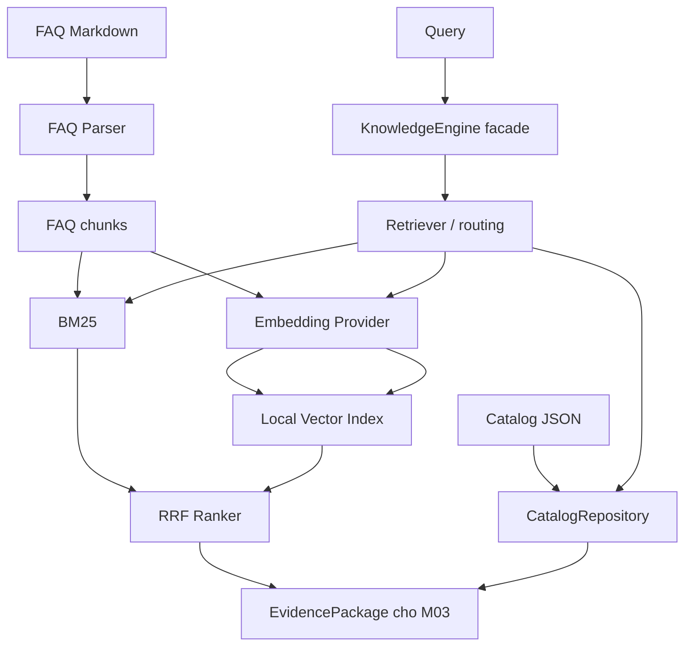

# Milestone 02 — Knowledge Engine, Semantic Retrieval và Hybrid RAG

Kết quả nghiệm thu ngày **28/10/2026**: code, offline tests, index thật và live OpenAI Embeddings smoke đã chạy. M02 cung cấp nguồn ứng viên và thông tin truy vết cho M03. Các giới hạn OOD và chất lượng ranking được ghi rõ bên dưới; đây chưa phải hệ thống trả lời bán hàng tự động.

## 1. Tổng quan M02

Mục tiêu là nạp 2 sản phẩm và 39 FAQ, tìm FAQ theo ba mode, đối chiếu dữ liệu Catalog trực tiếp và bàn giao evidence có metadata. M02.1 preparation và M02.2 BM25 được giữ nguyên behavior. M02.3 bổ sung OpenAI Embeddings, local cosine index; M02.4 bổ sung RRF và routing; M02.5 bổ sung evaluation và gói evidence.

Không có LLM generation, Conversation Memory, Answer Verification, thanh toán, TTS, lip-sync hoặc Speech Scheduler trong M02. Search hit, evidence package và điểm similarity không phải câu trả lời đã xác minh.

## 2. Kiến trúc Modular RAG



| File source | Trách nhiệm |
|---|---|
| `knowledge_engine.py` | API nội bộ, load/build/attach index, giữ interface cũ |
| `knowledge/models.py` | FAQRecord, FAQChunk, CatalogEvidence, RetrievalHit, EvidencePackage, cấu hình/manifest nội bộ |
| `catalog_repository.py` | Catalog lookup có validation, giữ null và trả bản sao |
| `faq_parser.py` | Parse FAQ theo cấu trúc, giữ Markdown và ghi chú evidence |
| `chunking.py` | 1 FAQ thành 1 chunk ổn định |
| `lexical_retriever.py` | Tokenizer và BM25 baseline |
| `embedding_provider.py` | SDK adapter, batching, validate vector và lỗi an toàn |
| `vector_index.py` | Exact cosine, fingerprint, manifest, save/load |
| `retriever.py` | Điều phối modes, đọc config, SKU routing, Catalog facts và guards |
| `ranker.py` | RRF bằng ranks và SKU bonus có giới hạn |

Facade giúp Agent không phụ thuộc chi tiết SDK, JSON persistence, BM25 hoặc cosine. Các thuật toán nằm ở module chuyên trách. Không tạo thêm Python file trong `src/`; chỉ sửa sáu file được phép của nhiệm vụ này.

## 3. Input Sources và ID

- Catalog có `LAPTOP-ASUS-001`, `LAPTOP-LENOVO-002`; giá/tồn kho là **mock**, không phải báo giá hoặc tồn kho thực tế.
- FAQ có 10 ASUS, 10 Lenovo, 11 Compare, 8 Sales. ID dùng dấu `-`; source refs là `catalog:<SKU>` và `faq:<FAQ-ID>`.
- Catalog là nguồn ưu tiên cho giá, tồn kho và thông số. FAQ là nội dung tư vấn tham khảo do nhóm biên soạn.
- Không sửa dữ liệu mock, ID hoặc nhãn baseline để tăng metric. Mock comments không được gửi tới Embeddings API.
- Public Pydantic Data Contracts và logic M01 không bị thay đổi.

## 4. Knowledge Preparation

Parser chỉ nhận mục `### FAQ-... — ...`; quy tắc bán hàng, fallback, ghi chú và timeline ngoài FAQ không thành chunk. FAQRecord giữ title, SKU, question, answer suggestion, follow-up, raw evidence, refs, notes, review status và source file. SKU lạ, ref Catalog không tồn tại, ID trùng hoặc thiếu field quan trọng đều báo lỗi.

**1 FAQRecord = 1 FAQChunk**, không cắt rời câu hỏi/trả lời, không overlap. `retrieval_text` gồm title, question và answer suggestion nguyên văn Markdown. Metadata giữ `faq_id`, `sku_ids`, `source_file`, `evidence_refs`, `evidence_notes`, `needs_review`. Dòng `---` trong câu trả lời được giữ; dấu phân cách sau dòng trống ở cuối Bằng chứng trước heading tiếp theo là quy ước cấu trúc của nguồn hiện tại.

Facade biểu diễn file trong repo bằng đường dẫn tương đối POSIX, ví dụ `shared_data/inputs/product_faq.md`, để fingerprint không phụ thuộc ổ đĩa Windows. Nguồn ngoài repo nên truyền `source_id` logic ổn định; nếu không, đường dẫn đầu vào được giữ nguyên và có thể khác giữa các máy.

Hiện có 6 mục cần review: FAQ-LENOVO-008/009, FAQ-COMPARE-010, FAQ-SALES-002/003/006. Parser chỉ trích xuất catalog ref tường minh; các cụm “nguồn tham khảo Lenovo”, “Catalog hai SKU”, “không có benchmark”, trạng thái PoC và ghi chú Memory vẫn là notes. Những mục này vẫn có thể được retrieval, không bị tự đánh dấu đã xác minh.

## 5. Lexical Retrieval

BM25 Okapi dùng `k1=1.5`, `b=0.75`:

```text
IDF(t) = log(1 + (N - df(t) + 0.5) / (df(t) + 0.5))
BM25(d,q) = SUM_t IDF(t) * tf(t,d)*(k1+1)
                    / (tf(t,d) + k1*(1-b+b*len(d)/avgdl))
```

Thống kê luôn tính trên corpus đầy đủ; mỗi token query được tính một lần. Chỉ trả điểm dương; đồng điểm theo chunk_id. `search_faq()` vẫn giữ behavior M02.2.

Tokenizer NFC + casefold + regex Unicode, giữ dấu tiếng Việt, `không`, RAM/SSD/CPU. Nó chưa phân đoạn từ ghép, không hiểu từ đồng nghĩa; `2.8K` bị tách thành các token. Chữ “Lenovo” không tự trở thành bộ lọc cứng trong API search thô.

## 6. Semantic Retrieval

Tên model lấy duy nhất từ `configs/app.yaml: rag.embedding_model`: **text-embedding-3-small**. `configs/rag.yaml` chỉ chứa tham số vận hành. Cấu hình hiện dùng dimensions `null`, tức để model quyết định; live response thực tế có **1536 chiều**. Không áp dụng giả định chiều này cho các model khác.

`OpenAIEmbeddingProvider` có `embed_documents()` và `embed_query()`, cho phép inject SDK client trong test. Batch hiện là 32: 39 FAQ cần 2 document requests. Adapter kiểm tra input không rỗng, count, response.index, model, chiều, số hữu hạn và norm khác zero. SDK response được sắp lại theo index để khớp đúng thứ tự input.

SDK chỉ được tạo khi bên gọi chủ động tạo provider. CLI chỉ nạp `.env` bằng python-dotenv khi có `--allow-api`; environment có sẵn được ưu tiên. Không in key, header hoặc exception SDK gốc. Thiếu key, lỗi xác thực, quota/rate limit, timeout, network và response lỗi có mã lỗi riêng. Chỉ dùng retry của SDK (`max_retries=1`, tối đa cấu hình 2), timeout hiện 30 giây; không retry chồng ở adapter.

Query và document phải cùng provider/model/chính sách dimensions. Query cache tối đa 128 mục nằm trong bộ nhớ một engine, được xóa khi attach provider/index mới; không ghi query ra index. Không embed lại corpus khi search.

Tích hợp dựa trên [OpenAI Embeddings API Reference](https://developers.openai.com/api/reference/python/resources/embeddings/methods/create) và [official OpenAI embeddings guide](https://developers.openai.com/api/docs/guides/embeddings). SDK dùng `client.embeddings.create`, encoding float và dimensions nếu được cấu hình; không dùng Chat/Responses API.

## 7. Local Vector Index

File mặc định: `shared_data/indexes/rag/index.json`, được Git ignore. Một file chứa `manifest`, `chunks`, `vectors`, tránh nhiều snapshot trùng nhau. Cosine tính trên vectors được chuẩn hóa norm; xếp giảm dần và tie-break theo chunk_id. Không cần GPU hoặc vector database server.

Manifest chứa schema version 1, provider/model, dimension thực tế, requested_dimensions, SHA-256 source fingerprint, SHA-256 payload checksum, chunk count, chunking/metric configuration và built_at UTC. Index live có 39 chunks, provider openai, model text-embedding-3-small, dimension 1536.

Fingerprint hash title/question/answer nằm trong retrieval_text và toàn bộ metadata liên quan của chunks, sắp theo chunk_id. Đổi nội dung, SKU, evidence notes hoặc review status sẽ cần rebuild. Catalog không được embed; lookup luôn đọc snapshot Catalog khi engine khởi tạo, không lấy giá từ FAQ.

Load kiểm tra schema/metadata/checksum, duplicate IDs, vector count/dimension, model/provider và fingerprint hiện tại. Thay đổi model hoặc chính sách dimensions (kể cả `null` thành số cụ thể) yêu cầu rebuild. Index cũ không được dùng âm thầm hoặc tự rebuild bằng API.

Save dùng file tạm cùng thư mục, flush/fsync rồi atomic replace. Chỉ lưu tên `index.json`, cấm cây `shared_data/inputs`; không dùng pickle. Nếu quá trình replace lỗi, index cũ còn nguyên. Đường dẫn tùy chọn cho phép test dùng tmp_path.

Rebuild có chủ đích:

```powershell
python scripts/script_rag/build_index.py --rebuild --allow-api
```

Nếu index tương thích tồn tại, lệnh build mặc định reuse và không cần key/mạng. Nếu chưa có index, mặc định chỉ in dry-run. Đừng xóa/sửa source để làm index “hợp lệ”.

## 8. Hybrid Retrieval và Query Handling

Hybrid lấy tối đa `max(top_k, candidate_k)` mỗi nguồn, mặc định candidate_k=20, rồi dùng:

```text
RRF(d) = SUM_i 1 / (rrf_k + rank_i(d)), rrf_k mặc định 60
```

Không cộng BM25 score với cosine. Dedup theo chunk_id, giữ component scores/ranks để debug. Nếu hai nguồn trả cùng chunk mà metadata khác nhau thì báo lỗi. Tie-break ổn định theo chunk_id.

SKU bonus mặc định 5%, tối đa 10% theo cấu hình, nhân vào RRF khi FAQ có đúng tập SKU scope đã rõ. Không có scope thì không boost; không ưu tiên tên hãng. Filter của cả BM25 và cosine yêu cầu FAQ có **tất cả** SKU được truyền; FAQ Compare không bị mặc định loại bỏ.

`search()` trả ứng viên thô để đo retrieval. `retrieve()` là entry point gói evidence cho M03: nhận diện SKU/brand/model tường minh từ Catalog, không áp Active SKU ngầm; “máy đó/con kia” thiếu SKU trả insufficient_evidence. Scope mâu thuẫn sản phẩm được nhắc rõ trả SKU_SCOPE_CONFLICT. Query về field chính xác nhưng thiếu SKU trả SKU_REQUIRED; M03 cần hỏi lại hoặc phân giải context.

Heuristic domain_terms là guard minh bạch, không phải OOD classifier được huấn luyện. Hai probe “ASUS dự báo thời tiết...” và “Laptop nấu phở...” vẫn bị nhận nhầm. Không có tuyên bố xử lý OOD triệt để, không dùng một score > 0 để khẳng định đã biết câu trả lời.

## 9. Evidence Safety

`get_catalog_evidence(sku_id, field_path)` cung cấp giá trị trực tiếp. Routing nhận diện giá/tồn kho và nhóm RAM, SSD, CPU, GPU, màn hình, pin, cổng, cấu hình. Khi có nhiều SKU rõ, package lấy Catalog của tất cả SKU đó. Nếu chưa xác định field cụ thể, package có thể chứa bản ghi sản phẩm đầy đủ. Đây là keyword routing baseline, không phải intent model.

CatalogEvidence giữ value nguyên gốc: ASUS SSD upgradable vẫn `None`; không biến thành `False`. Chưa có field webcam trong Catalog thì không tự tạo fact webcam. Giá/stock mock không thành cam kết thực tế.

FAQ hits luôn giữ source_ref, SKU, evidence_refs, notes, review status. Reference tồn tại chỉ chứng minh truy vết được; `needs_review=False` không bảo đảm claim đúng. EvidencePackage status `ok` chỉ nghĩa có ứng viên/nguồn, không phải verification verdict. Có warnings khi hits chứa FAQ_NEEDS_REVIEW. M03 phải tự kiểm tra từng claim trước khi tạo AgentResponse answered.

## 10. Retrieval Evaluation

Baseline **lexical_eval.json được giữ nguyên**: 12 câu, một nhãn kỳ vọng mỗi câu. Bộ mới `retrieval_eval.json` có 24 query IDs, category, relevant IDs, expected SKU và notes: 17 câu có nhãn retrieval, 7 câu rejection/OOD/ambiguous. Nhãn do người viết chọn, chưa có review độc lập và chưa bao phủ mọi câu hợp lệ.

- Macro Recall@K = trung bình `|topK giao relevant| / |relevant|` trên các câu relevant không rỗng.
- MRR@10 = trung bình nghịch đảo hạng hit liên quan đầu tiên, bằng 0 nếu không có trong top 10.
- Relevant rỗng không vào mẫu số Recall/MRR; đo rejection riêng qua EvidencePackage.
- Recall dùng raw search trên toàn corpus, **không truyền expected SKU từ nhãn vào ranking**. SKU filter correctness là phép đo riêng, có explicit scope.
- Source integrity đối chiếu FAQ ID, source_ref, SKU, refs, notes và review flag với nguồn đã parse. Không đo answer faithfulness vì chưa có answer generator/verifier.

Kết quả live thực đo, cùng model/index/config trên cả ba mode:

| Bộ 24 câu: 17 relevant | Recall@1 | Recall@3 | Recall@5 | MRR@10 |
|---|---:|---:|---:|---:|
| Lexical | 0.588 | 0.853 | 0.882 | 0.754 |
| Semantic | 0.824 | 0.971 | 1.000 | 0.961 |
| Hybrid | 0.706 | 0.912 | 0.941 | 0.882 |

| Baseline 12 câu | Recall@1 | Recall@3 | Recall@5 | MRR@10 |
|---|---:|---:|---:|---:|
| Lexical | 0.750 | 0.917 | 0.917 | 0.819 |
| Semantic | 0.917 | 1.000 | 1.000 | 0.944 |
| Hybrid | 0.833 | 0.917 | 0.917 | 0.875 |

Với bộ mới, cả ba mode có source integrity **170/170** hits, explicit SKU filter correctness **13/13** query scopes. Guard từ chối **5/7** trường hợp rejection, còn **2 false accepts** (OOD có tên hãng/từ domain). Có **1 false reject** trên 17 câu relevant: câu pin 75Wh chưa nêu SKU bị yêu cầu làm rõ. Đây là đo behavior guard, không phải accuracy phân loại ngữ nghĩa.

Những thất bại cần lưu ý:

- Câu so sánh tổng quát kỳ vọng FAQ-SALES-008: lexical và hybrid không có trong top 5. RRF equal-weight bị BM25 kéo về các FAQ so sánh từng tiêu chí; semantic tốt hơn ở đây.
- Câu Lenovo RAM upgrade SSD bằng tiếng Anh: lexical chưa đưa hai FAQ chuyên biệt vào top 3.
- Câu pin 75Wh/cam kết 12 tiếng có nhiều nhãn; FAQ cảnh báo benchmark đứng hạng 4 nên Recall@3 chỉ đạt 0.5 ở cả ba mode.
- Hybrid cải thiện so với lexical trên bộ mới nhưng **kém semantic**. Chưa có bằng chứng nên đổi mode mặc định; vẫn để lexical offline. Không sửa labels hoặc FAQ IDs để che kết quả.

Latencies trong lần đo bộ mới: lexical local khoảng 0.008s; semantic tổng 7.915s, trong đó SDK/network 7.761s; hybrid local khoảng 0.199s. Hybrid dùng query cache đã được semantic làm nóng nên API=0 ở lượt đó, **không thể so trực tiếp như cold-start latency**. Số local là tổng thời gian trừ thời gian adapter SDK, không phải profiler chi tiết. Bộ mới dùng 19 query embedding requests/277 token; baseline dùng 12 requests/159 token.

Artifacts thực đo nằm ở `shared_data/indexes/rag/evaluation_live.json`, `baseline_live.json`; file generated được ignore Git. Số đo trong bảng không lấy từ mock vectors.

Ví dụ Top-5 raw search: **ASUS nâng RAM được không?**, không explicit SKU filter:

| Rank | Lexical: FAQ / BM25 | Semantic: FAQ / cosine | Hybrid: FAQ / RRF |
|---|---|---|---|
| 1 | ASUS-004 / 6.2692 | ASUS-004 / 0.7860 | ASUS-004 / 0.0328 |
| 2 | COMPARE-003 / 5.6863 | COMPARE-003 / 0.6517 | COMPARE-003 / 0.0323 |
| 3 | COMPARE-011 / 5.6461 | ASUS-005 / 0.6456 | COMPARE-011 / 0.0313 |
| 4 | LENOVO-003 / 5.5112 | LENOVO-003 / 0.6372 | LENOVO-003 / 0.0312 |
| 5 | COMPARE-010 / 4.1546 | COMPARE-011 / 0.6079 | ASUS-005 / 0.0308 |

Các ID trong bảng đều có tiền tố `FAQ-`. Ba thang điểm khác nhau không phải xác suất đúng.

## 11. Test Results và Live Smoke

Môi trường kiểm tra: Windows, Python 3.13.2; OpenAI SDK 2.54.0, python-dotenv 1.2.4. Baseline trước sửa: 299 passed, 65 subtests passed.

Các phase đã chạy tuần tự: provider/index 35 test PASS; ranker/retriever 9 PASS; config/integration 14 PASS; sau đó chạy regression đầy đủ. Kết quả cuối:

| Phạm vi | Kết quả thực tế |
|---|---|
| Unit `tests/unit/test_part1_code` | 149 passed |
| Part 1 contracts | 17 passed |
| `tests/integration` | 3 passed |
| Full repository | 375 passed, 65 subtests passed |
| Prepare knowledge | 2 products, 39 FAQ, 39 chunks, 6 needs_review |
| Build reuse | Load index thật thành công, không API |
| Live smoke | PASS: authenticate, 39 chunk build, semantic/hybrid queries |

Dùng `-p no:cacheprovider` vì quyền cache Windows trước đó; không bỏ test hoặc sửa assertions cũ. Suite offline chặn socket connections và dùng test-only provider inject từ fixture. Integration lưu index vào tmp_path và kiểm tra source bytes không đổi. Không dùng mock để báo chất lượng semantic production.

Live smoke đã chạy bằng `build_index.py --allow-api --smoke`: một input ngắn kiểm tra trước, 2 batch cho 39 FAQ, 2 query embeddings được dùng chung cho semantic/hybrid. Tổng **5 request, 6.000 token**, actual dimension 1536. Lần thử ban đầu trong sandbox bị chặn network; khi được cấp quyền mạng, live smoke đạt. Không log credentials, không gửi mock comments, không thử nhiều model.

Lần regression mới nhất bao gồm 2 test xử lý thư mục tạm Windows và 6 test import CLI: ba script chạy trực tiếp từ ngoài root hoặc chạy bằng `python -m` tại root, không phụ thuộc PYTHONPATH. CLI tự bổ sung project root trước khi import `scripts.script_rag._common`.

Kiểm tra chất lượng answer faithfulness và kiểm chứng claim bằng LLM: **NOT RUN — ngoài phạm vi M02**.

## 12. CLI Commands

Tại root repository, dùng cùng interpreter/venv đã cài dependencies:

```powershell
python -m pip install -r requirements.txt
python scripts/script_rag/prepare_knowledge.py
python scripts/script_rag/build_index.py
python scripts/script_rag/build_index.py --allow-api --smoke
python scripts/script_rag/build_index.py --rebuild --allow-api
python scripts/script_rag/search_faq.py "ASUS nâng RAM được không?" --top-k 5
python scripts/script_rag/search_faq.py --eval
python scripts/script_rag/search_faq.py "Giá Lenovo bao nhiêu?" --mode semantic --allow-api
python scripts/script_rag/search_faq.py "ASUS so với Lenovo" --mode hybrid --allow-api --sku LAPTOP-ASUS-001 --sku LAPTOP-LENOVO-002
python scripts/script_rag/evaluate_rag.py
python scripts/script_rag/evaluate_rag.py --allow-api --output shared_data/indexes/rag/evaluation_live.json
python scripts/script_rag/evaluate_rag.py --dataset tests/fixtures/rag/lexical_eval.json --allow-api --output shared_data/indexes/rag/baseline_live.json
python -m pytest tests/unit/test_part1_code -v -p no:cacheprovider
python -m pytest tests/contract/test_part1_contract.py -v -p no:cacheprovider
python -m pytest tests/integration -v -p no:cacheprovider
python -m pytest -q -p no:cacheprovider
```

`.env` chứa tên biến `OPENAI_API_KEY` ở máy local; `.env.example` chỉ có placeholder. Không cần key cho lexical hoặc tests. Mỗi CLI gọi API đều yêu cầu `--allow-api`; thiếu index, sai model hoặc không có quyền API sẽ báo lỗi có thể xử lý. Có thể dùng `--app-config`, `--rag-config`, `--index-path` để chọn đường dẫn; đổi config cần rebuild nếu không tương thích.

Trên Windows, `tests/conftest.py` tự chọn `.pytest-temp/run-<UUID>` riêng cho mỗi phiên và dọn đúng thư mục đó khi kết thúc. Không cần đặt lại TEMP/TMP khi mở terminal mới; `.pytest-temp` được Git ignore. Nếu truyền `--basetemp`, đường dẫn đó được ưu tiên và người gọi tự quản lý vòng đời.

`-p no:cacheprovider` chỉ tắt `.pytest_cache`, không sửa lỗi quyền của fixture `tmp_path`. Lỗi `WinError 5` tại `Temp/pytest-of-...` xuất hiện ở bước setup nên CLI có thể chạy bình thường trong khi các test cần file tạm lại lỗi. Hook mới tránh dùng thư mục Temp cũ mà không chỉnh ACL/quyền hệ thống hoặc xóa dữ liệu cũ. Không cần mở IDE bằng quyền quản trị.

## 13. Limitations

Corpus chỉ có 2 sản phẩm và 39 FAQ. Bộ đánh giá nhỏ, chưa độc lập; Recall@5=1.000 ở một mode không đồng nghĩa chính xác tuyệt đối. RRF chưa tối ưu trên tập phát triển độc lập, không có reranker nặng. Domain guard có false positives/false negatives đã đo, chưa xử lý OOD tổng quát hoặc prompt injection như một hệ thống production.

Query router là heuristic từ khóa, không có Conversation Memory; câu hỏi mơ hồ cần M03 phân giải. Source fingerprint bảo vệ snapshot chunk/metadata, không thay thế xác minh nội dung nguồn. Query cache là bộ nhớ cục bộ, chưa thiết kế phục vụ multi-user dài hạn. Chưa có kiểm soát token tự động cho mọi input lớn tùy ý; CLI smoke/evaluation giới hạn số input và batch.

Không có LLM generation, answer faithfulness, kiểm chứng claim, đơn hàng hoặc thanh toán thật. Agent không được dùng score hoặc status ok để bỏ qua verification. Semantic/hybrid cần API cho query chưa có cache, dù index đã nằm local.

## 14. Milestone 02 Acceptance Criteria

| Hạng mục | Trạng thái / evidence |
|---|---|
| M02.1/M02.2, IDs và baseline còn hoạt động | PASS — prepare và baseline eval giữ kết quả |
| Embedding adapter batching/validation/error handling | PASS — SDK mock tests và live smoke |
| Vector build/load/search/persistence | PASS — unit/integration và reuse index thật |
| Phát hiện stale source/model/dimension | PASS — regression tests |
| Semantic và hybrid/RRF | PASS — công thức unit test + API thật |
| SKU filters và multi-SKU metadata | PASS — 13/13 explicit scopes, unit/integration |
| Source/evidence integrity | PASS trong corpus — 170/170 hits được đo |
| Empty/ambiguous/OOD handling có lỗi/status rõ | PASS chức năng; CHẤT LƯỢNG OOD CÒN HẠN CHẾ — 2 false accepts |
| Không tạo claim hoặc sửa review flag | PASS phạm vi code/test; không phải answer verification |
| Evaluation và Recall/MRR thực đo | PASS — hai dataset, ba mode, báo cả kết quả thấp |
| Tests offline không mạng/key | PASS — socket guard và dependency injection |
| M01/public contracts/Part 2/3 giữ nguyên | PASS — không sửa source các phần này, full regression đạt |
| CLI và rebuild guide | PASS — dry-run/reuse/API gate/explicit rebuild |
| Không tạo Python file mới trong src | PASS — chỉ sáu source file được phép bị sửa |
| Không commit/push | PASS |
| Secrets và generated index không đưa vào Git | PASS phạm vi thay đổi — `.env` và indexes bị ignore, không in key |
| Live API smoke | PASS — model thật, dimension thật, requests/tokens thật |
| Answer generator/verifier | NOT RUN — bàn giao M03, không thuộc M02 |

M02 đạt triển khai và nghiệm thu **PoC** với các giới hạn được công khai. Không coi checklist này là chứng nhận chất lượng production hoặc khả năng trả lời tự động mọi câu hỏi.

## 15. Handoff to Milestone 03

Interfaces giữ nguyên: `get_product`, `get_faq`, `list_faq_chunks`, `search_faq` (BM25). Interfaces mới:

```python
# lexical mặc định, không SDK/key/mạng
engine = load_knowledge(catalog_path, faq_path, config=config)
engine.search(query, mode="lexical", top_k=5, sku_ids=None)

# provider được inject rõ; load không embed lại corpus
engine.load_vector_index(index_path, provider)
engine.index_status()
package = engine.retrieve(query, mode="hybrid", top_k=5, sku_ids=None)
engine.get_catalog_evidence("LAPTOP-ASUS-001", "specifications.storage.upgradable")
```

`RetrievalHit` có chunk/source_ref, score/rank, metadata, retrieval_text, mode và component scores/ranks. `EvidencePackage` có status/reason, resolved SKU IDs, FAQ hits, CatalogEvidence và warnings; không chứa AgentResponse hoặc lời thoại. Semantic/hybrid thiếu provider/index phải báo lỗi, không fallback sang embeddings giả hoặc build ngầm.

M03 cần xử lý EMPTY_QUERY, OUT_OF_DOMAIN, AMBIGUOUS_SKU, SKU_REQUIRED, SKU_SCOPE_CONFLICT, NO_MATCH và lỗi provider/index. `no_hit` hoặc `insufficient_evidence` là cơ sở hỏi lại/chặn; status ok vẫn chỉ là ứng viên. Nếu so sánh nhiều SKU, phải giữ đủ các nguồn. Không dùng active SKU làm suy đoán cho “máy đó” khi thiếu context đáng tin cậy.

Agent phải giữ source refs và review notes, dùng Catalog cho giá/tồn kho/thông số, không đọc giá FAQ cũ thay thế facts. Không được suy diễn None thành False, không cam kết FPS/thời lượng pin/chính sách chưa có nguồn, không tuyên bố đơn hàng được tạo. Chỉ sau verification của M03 mới chuyển sang public AgentResponse phù hợp; M02 không thay đổi 10 public contracts.
